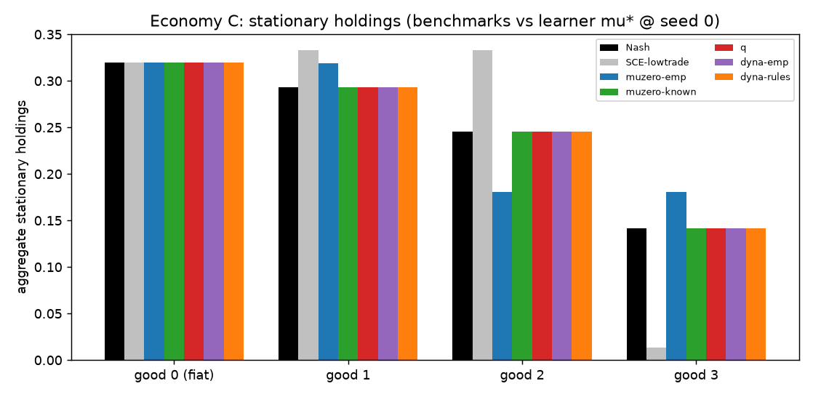
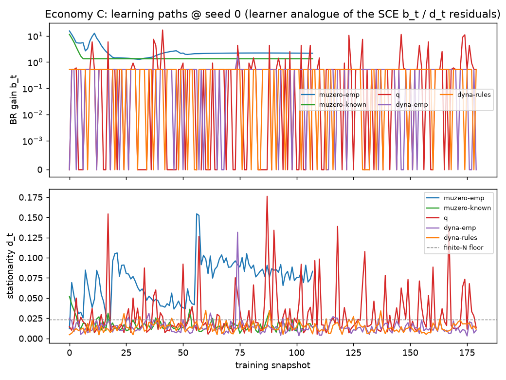
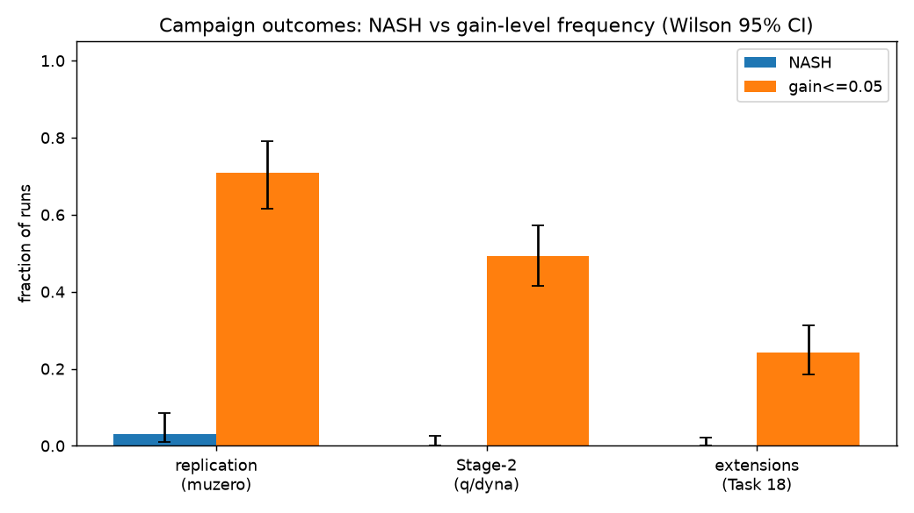

# Money from Learning: Final Report on the Kiyotaki-Wright Replication

This report explains, for a reader who knows neither this codebase nor the
source paper, what we built, what we measured, and what we found. It is the
narrative companion to [tables.md](tables.md) (thirteen numbered tables,
referenced below as Table 1, Table 2, and so on), to the figures in
[figures/](figures/), and to the raw analysis log in
[findings.md](../findings.md). Every number below appears in one of those
artifacts.

The source is Sargent and Yang (June 2026 draft), "How Should I Trade?
Stationary Nash, Self-Confirming, and Learned Equilibria in Kiyotaki-Wright
Exchange Economies." We reimplemented the paper's three algorithms from
scratch, verified them against the paper's printed results, replaced the
paper's learner with standard reinforcement-learning baselines, ran
multi-seed statistical campaigns, and ran five extension experiments the
paper only conjectures about.

## 1. Overview and headline findings

The paper asks how money emerges. In a Kiyotaki-Wright economy, agents who
cannot always trade what they produce for what they consume may accept an
intermediate good, a commodity money or a worthless fiat token, purely
because they expect others to accept it later. Whether that expectation is
correct depends on what everyone else does, so "which good becomes money"
is an equilibrium question. The paper computes two kinds of equilibrium
benchmarks and then asks which of them populations of learning agents
actually reach.

We already know that learners rarely reach full Nash equilibrium here; the
paper says so, and our campaigns confirm it overwhelmingly (Section 7). The
sharp question is therefore not whether Nash fails but what the learners
reach instead: do they settle into *self-confirming equilibria*, points
where every agent plays optimally against beliefs that its own experience
never contradicts? Our answer, developed in Section 9, is nuanced:

1. **The trapped endpoints carry the self-confirming signature but fail
   strict on-path belief consistency.** Replaying key trapped runs shows
   agents playing optimally against their own learned beliefs to machine
   precision (subjective optimality residual near $10^{-11}$), while a
   complete-information deviation would gain them between 0.09 and 34
   utility units per period. That is exactly the "subjectively optimal,
   objectively poor" structure of a self-confirming equilibrium. However,
   the learned beliefs sit 0.22 to 0.50 away from the frequencies the
   deployed policy actually generates, because the beliefs average over the
   entire exploratory training history rather than over the equilibrium
   path. Under the strict classifier these endpoints are therefore
   "unsettled," not certified self-confirming traps.

2. **Dyna, the model-based baseline, is not uniformly trap-prone, and where
   it traps the mechanism is informative** (Section 8). Planning over a
   learned model rescues some economies outright and, in one case, finds an
   equilibrium the paper's own learner missed. But when the learned model
   is wrong, planning transmits the belief error into a confidently held
   wrong policy. Model-free Q-learning fails more noisily; Dyna fails more
   confidently.

3. **The paper's conjectured fix, exponential-moving-average forgetting of
   the world model, works exactly where and only where the paper predicts**
   (Section 10.2). It removes economy D's stale-belief plateau and never
   helps economy C, whose failure is a data-availability problem that no
   averaging scheme can repair.

## 2. The economic environment

### 2.1 One period of life

The economy has $|I|$ agent types and $|G|$ storable goods. A type-$i$
agent produces good $f(i)$, wants to consume a different good
$c_i$, and can store exactly one unit of one good at a time. Storing good
$h$ costs $s(h)$ per period; goods differ widely in storage cost, which is
what makes "which good should I hold?" a real decision.

Each period has two stages:

- **Trade stage.** Agents are matched in pairs at random. If agent A holds
  good $k$ and meets an agent holding good $j$, A chooses whether to offer
  a swap. A trade happens only if both sides offer ($\chi = 1$ exactly when
  $k \neq j$ and both agents accept).
- **Consumption stage.** An agent holding some good decides whether to
  consume it ($\gamma = 1$) or keep storing it. Consuming yields utility
  $\bar u_i$ if the good is the agent's consumption good, and the agent
  immediately produces a fresh unit of $f(i)$.

The per-period reward of a type-$i$ agent holding good $h$ who makes
consumption choice $\gamma$ is

$$r_i(h, \gamma) \;=\; \gamma\,\bigl(\bar u_i \cdot \mathbf{1}\{h = c_i\} - s(f(i))\bigr) \;+\; (1-\gamma)\,\bigl(-s(h)\bigr),$$

that is: consume and pay the storage cost of the newly produced good, or
hold and pay the storage cost of the current good. Agents maximize their
long-run *average* reward per period (an undiscounted criterion), which is
the natural objective for an economy that runs forever.

A policy for type $i$ is a pair of tables: $\alpha_i(k, j) \in [0, 1]$, the
probability of offering to trade held good $k$ against a counterparty
holding $j$, and $\beta_i(h) \in [0, 1]$, the probability of consuming
while holding $h$.

### 2.2 The five economies

The paper studies five parameterizations (paper section 5; types and goods
are 1-indexed here, as in the paper):

| Economy | Types x Goods | Production map $f$ | Storage costs $s$ | Utility $\bar u$ | What it tests |
|---|---|---|---|---|---|
| A1 | 3 x 3 | $f(1){=}2,\ f(2){=}3,\ f(3){=}1$ | $(0.1,\ 1,\ 20)$ | 100 | Fundamental commodity money: the cheapest-to-store good (good 1) circulates |
| A2 | 3 x 3 | same as A1 | same as A1 | **500** | Speculative money: with utility this high, accepting the *expensive* good 3 becomes an equilibrium strategy |
| B | 3 x 3 | $f(1){=}3,\ f(2){=}1,\ f(3){=}2$ | $(1,\ 4,\ 9)$ | 100 | Two coexisting equilibrium branches |
| C | 3 x 4 | $f(1){=}2,\ f(2){=}3,\ f(3){=}1$ | $(0,\ 9,\ 14,\ 29)$ | 100 | **Fiat money**: good 0 cannot be consumed or produced by anyone; a fixed stock $M_0 = 0.32$ circulates only if everyone believes it will |
| D | 5 x 5 | $f(1){=}3,\ f(2){=}4,\ f(3){=}5,\ f(4){=}1,\ f(5){=}2$ | $(1,\ 4,\ 9,\ 20,\ 30)$ | 200 | A larger barter economy with a longer chain of intermediate trades |

Economy C is the hardest and the most economically interesting: fiat money
is intrinsically worthless, so the monetary equilibrium survives only on
mutually consistent beliefs. It is where learning fails most often, and
most instructively.

### 2.3 Population dynamics

Simulations use $N = 1800$ agents (600 per type in the three-type
economies) trading for 35 rounds per learning iteration. For diagnostics we
work with the *population distribution* $\mu_i(k)$, the fraction of type
$i$ holding good $k$. Given a policy profile $\sigma = (\alpha, \beta)$,
one period maps $\mu$ forward deterministically:

- Aggregate holdings: $\mu(k) = \sum_i \nu_i\, \mu_i(k)$, where $\nu_i$ is
  type $i$'s population share.
- Reciprocation rate: the probability that a random holder of good $j$
  offers it for your good $k$ is
  $Q(k, j) = \sum_{\ell} \eta_\ell(j)\, \alpha_\ell(j, k)$, with
  $\eta_\ell(j) = \nu_\ell\, \mu_\ell(j) / \mu(j)$ the share of
  $j$-holders who are type $\ell$.
- Trade flows: $F_i(k, j) = \mu_i(k)\, \mu(j)\, \alpha_i(k, j)\, Q(k, j)$,
  followed by the consumption and production step.

Call the resulting one-period map $F_\sigma$. A distribution is
*stationary* for $\sigma$ if $F_\sigma(\mu) = \mu$. The code finds this
fixed point by damped forward iteration to a residual of $10^{-12}$
(`src/kw/distributions.py`).

## 3. Solution concepts and how we measure them

### 3.1 Stationary Nash equilibrium and the best-response gain

A *stationary Nash equilibrium* is a policy profile $\sigma$ together with
its stationary distribution $\mu$ such that no type can raise its long-run
average reward by deviating unilaterally, holding the population's behavior
fixed. Our headline diagnostic is the **best-response gain**

$$b \;=\; \max_i\ \bigl[\, g_i^{\mathrm{BR}}(\mu, \sigma) - g_i^{\sigma}(\mu, \sigma) \,\bigr],$$

where $g_i^{\sigma}$ is type $i$'s average reward per period under its
current policy and $g_i^{\mathrm{BR}}$ is the best average reward any
single type-$i$ agent could earn against the same population. We compute
$g_i^{\mathrm{BR}}$ by *relative value iteration*, the standard dynamic
programming method for average-reward problems, and $g_i^{\sigma}$ by
solving the linear policy-evaluation equations. At an exact Nash
equilibrium $b = 0$; a gain of $b = 1$ means some type is leaving one
utility unit per period on the table. Because consuming is worth 100 to
500 units, gains of 10 or more indicate first-order broken behavior, while
gains below 0.05 are economically negligible.

The second diagnostic is the **stationarity residual**
$d = \lVert F_\sigma(\mu) - \mu \rVert_\infty$: how far the measured
holdings distribution is from being a fixed point of the population map.

### 3.2 Self-confirming equilibrium

A *self-confirming equilibrium* weakens Nash in one specific way. Each type
$i$ carries a subjective model $\theta_i = (m_i, q_i)$ of the world: $m_i$
is its belief about whom it meets, and $q_i(k, j)$ its belief about the
probability that an offer of $k$ against $j$ is reciprocated. The
equilibrium conditions are:

1. **Subjective optimality.** Each type's policy is optimal *against its
   own beliefs* $\theta_i$ (measured by the residual $s$, the gap between
   the best subjective average reward and the achieved one).
2. **On-path belief consistency.** Beliefs match reality on every
   $(k, j)$ pair that actually occurs with positive probability under the
   equilibrium play (residual $b_{\mathrm{belief}}$, the largest on-path
   discrepancy $|q_i - Q^\sigma|$). Off the path, beliefs are
   unconstrained: nobody ever sees the evidence that would correct them.
3. **Stationarity** of the distribution (residual $d$).

The economic point: a self-confirming equilibrium can be objectively bad.
If everyone believes "nobody accepts good 3" and therefore never offers it,
the belief is never tested and never falsified, and an entire arm of the
trade network stays dark. The paper engineers such points deliberately with
"misdirectional prompts" (pessimistic initial beliefs), and our
Algorithm 2 reproduces them (Section 5).

### 3.3 The outcome classifier and the finite-population floor

Each learning run is classified from its deployed policy:

- **NASH** if $b \le 0.05$ and $d \le 10^{-3}$;
- **SCE_TRAP** (a certified self-confirming trap) if $b > 0.05$,
  $d \le 10^{-3}$, subjective optimality $s \le 0.05$, and on-path belief
  error $b_{\mathrm{belief}} \le 0.02$;
- **UNSETTLED** otherwise.

Two caveats govern everything downstream. First, the SCE_TRAP label needs
the learner's *beliefs*, and the standard run artifacts persist policies
and distributions but not beliefs, so campaign-level classification can
only distinguish NASH from UNSETTLED (`scripts/run_campaign.py`); belief
certificates come from targeted replays (Section 9). Second, the
stationarity leg is measured on the empirical holdings histogram of 1800
simulated agents, which fluctuates on the order of
$1/\sqrt{1800} \approx 0.024$ for any equilibrium with genuinely mixed
holdings. That sampling floor sits far above the $10^{-3}$ threshold, so
runs can reach a best-response gain of exactly zero and still classify
UNSETTLED. The informative cross-run signal is therefore the gain $b$
itself, and we report classification counts alongside gain-level counts
throughout. The one economy with a degenerate (pure-holdings) equilibrium,
A1, serves as the internal control: its stationarity residual is
$1.1 \times 10^{-16}$, machine zero, confirming that the floor elsewhere
is sampling noise and not an equilibrium failure (findings.md, H4).

## 4. The algorithms

### 4.1 Algorithm 1: the Nash solver

Damped best-response iteration. From the current policy profile, compute
the stationary distribution and reciprocation rates; solve each type's
average-reward dynamic program by relative value iteration; extract the
greedy best-response policy; move each type's policy a step of size
$\rho = 0.3$ toward it. Stop when the largest gain gap and the
distributional residual are both below tolerance. Different *initial*
policies ("directional prompts": for example, "type 1 starts willing to
accept good 3 speculatively") select different equilibrium branches where
several coexist.

### 4.2 Algorithm 2: the self-confirming equilibrium solver

The same skeleton with one substantive change: each type optimizes
against its
*subjective* model $\theta_i$, and after each policy update the beliefs are
corrected **only on the path of play**, that is, only on the $(k, j)$ pairs
the current policy actually visits. Off-path beliefs stay frozen at their
initial (possibly misdirected) values. The solver stops when subjective
optimality, on-path consistency, and stationarity all hold, then reports
the complete-information best-response gain as an external audit of how
objectively bad the point is.

### 4.3 Algorithms 3-4: the paper's learner

The paper's learner is a population of agents sharing tabular policy,
value, and world-model estimates, improved by self-play with Monte Carlo
tree search (the paper describes it as a tabular MuZero variant; the search
is PUCT, "predictor upper confidence bounds applied to trees"). Each
learning iteration simulates 35 trading rounds for all 1800 agents; at
decision points agents run a short lookahead search (32 simulations, depth
10) through a world model and act through the visit distribution; at the
end of the iteration the shared policy tables are mixed a step
$\zeta_n = \max(0.01,\ 0.45 \cdot 0.94^{\,n-1})$ toward the search
results, clipped to an exploration floor $\varepsilon = 0.03$.

The learner comes in two variants:

- **muzero-emp** (fully empirical): the world model is estimated from
  observed trade outcomes, meeting frequencies, and acceptance rates.
  Nothing about the true mechanics is given.
- **muzero-known**: the true one-step mechanics (trade resolution,
  production, rewards) are handed to the planner; only meeting frequencies
  $\hat m$ and acceptance rates $\hat q$ are still learned. Two further
  flags change the planner's backup operator from averaging to
  maximization (`greedy_backup`) and center values (`centered_values`).
  Section 10.1 disentangles which flag does what.

At the end of training, a separate deployment pass extracts a near-greedy
policy with a deeper search budget; all diagnostics score this deployed
policy.

### 4.4 Stage 2: standard reinforcement-learning baselines

To test how much of the paper's story depends on its specific learner, we
replaced it (behind the same simulator interface, with identical
population size, matching, rounds, exploration floor, and evaluation
pipeline) with three standard baselines spanning the model-use spectrum:

| Configuration | Planner | World model | Character |
|---|---|---|---|
| `q` | none | none (realized payoffs only) | **model-free** |
| `dyna-emp` | Dyna planning sweeps | learned empirical model | **model-based**, planning without knowledge |
| `dyna-rules` | Dyna planning sweeps | true mechanics (rules) | **model-based**, knowledge without tree search |

The `q` learner is *differential Q-learning* (Wan, Naik, and Sutton 2021),
the average-reward analog of ordinary Q-learning. It maintains trade-stage
and consumption-stage action-value tables and a running estimate
$\bar g_i$ of the average reward, updated from realized payoffs only:

$$\delta_C \;=\; r_C - \bar g_i + \max_{\lambda'} Q_T[i, h'', j', \lambda'] - Q_C[i, h, \gamma], \qquad Q_C \mathrel{+}= a\,\delta_C, \quad \bar g_i \mathrel{+}= \eta\, a\, \delta_C,$$

with learning rate $a = 0.1$ and $\eta = 0.5$, plus the analogous
trade-stage update.

**Dyna is the model-based member of this family, and that distinction
drives Section 8.** A Dyna learner runs the same Q-learning updates on real
experience, and additionally, after every real observation, performs
$K = 20$ *planning backups*: expected Bellman updates at states sampled
from the set of visited states, computed through a world model rather than
through new experience. `dyna-emp` plans through the same learned
empirical model the paper's empirical learner uses; `dyna-rules` plans
through the true mechanics and is, in effect, asynchronous relative value
iteration on the agent's subjective model, the closest planner-free analog
of the paper's known-environment learner. Behavior during training is
epsilon-greedy with the same floor $\varepsilon = 0.03$; deployment is
greedy with respect to the learned action values.

### 4.5 The stopping rule

All learners stop by the paper's rule (D1): stop when the mean absolute
per-iteration policy change over visited states stays below
$\delta = 0.003$ for 8 consecutive iterations, after a minimum of 100
iterations, with a hard cap at 180. One recorded finding matters for
interpretation: (D1) certifies that the *training tables have stopped
moving*, not that the policy is near equilibrium. All five economies stop
at exactly iteration 108 under the paper's learner because the mixing-rate
schedule, not the economics, controls when the update sizes shrink below
threshold (findings.md, "Why n_iters=108 everywhere"). Two economies stop
there while still 0.6 to 2.2 utility units short of Nash.

## 5. Benchmark verification: the equilibria exist and the solvers find them

**Nash benchmarks (H1).** Algorithm 1 converged on all seven
economy-by-prompt branches with gain gaps at or below $10^{-9}$ and
distributional residuals at or below $10^{-12}$, and the stationary
holdings match the paper's printed figures to their two-to-three decimal
rounding: the fundamental commodity-money equilibrium of A1 (aggregate
holdings $[0.500, 0.333, 0.167]$), the speculative branch of A2
($[0.5286, 0.2357, 0.2357]$, where type 1 accepts the most expensive good
in equilibrium), both branches of B, the fiat-money equilibrium of C
(aggregate $[0.3200, 0.2930, 0.2456, 0.1414]$ with the fiat stock pinned
at $M_0 = 0.32$), and the five-good equilibrium of D.

**Self-confirming benchmarks (H2).** Algorithm 2, started from the paper's
misdirectional prompts, converged to genuine self-confirming equilibria:
subjective optimality $s \le 10^{-9}$, on-path belief error
$\le 10^{-9}$, stationarity $\le 10^{-12}$. Their objective badness is
large and matches the paper: a complete-information deviation would gain
19.9 per period at the A1 autarky point (every type hoards its own
product because it believes nobody trades), 33.3 at the C low-trade point
(fiat circulation collapses), and 80.0 at the D partial-autarky point.
Started instead *from* the A1 Nash equilibrium, the same solver stays
there with gain below $10^{-6}$: Nash points are self-confirming, as
theory requires. One honest caveat: on economy D our converged point
matches the paper on four of five types but differs on type 2 (fully
specialized where the paper reports an interior 0.72). Both are valid
self-confirming equilibria; which one the solver reaches depends on how
indifferent, off-path policy entries are resolved, and the paper publishes
no prompt recipe that would disambiguate. We record it as a valid
equilibrium at a different endpoint, not a match.



*Figure: aggregate stationary holdings in economy C, one bar group per
good, comparing the Nash benchmark (black), the low-trade self-confirming
benchmark (gray), and each learner's seed-0 endpoint. Every learner holds
the fiat good at exactly its conserved stock 0.32; the empirical
tree-search learner (blue) misallocates goods 2 and 3 (0.18 each, against
the Nash values 0.246 and 0.141), which is the visible form of its 0.594
gain.*

## 6. Single-seed replication of the paper's learner

**Empirical learner (H3, paper Table 2).** One run per economy at seed 0,
paper-default configuration:

| Economy | Our deployed gain | Paper Table 2 | Reading |
|---|---|---|---|
| A1 | $5.05 \times 10^{-11}$ | $1.50 \times 10^{-12}$ | match (both are zero at this scale) |
| A2 | $6.18 \times 10^{-12}$ | 21.3 | our seed *found the speculative equilibrium*; the paper's run stayed in the fundamental basin, which is not a best response at $\bar u = 500$ |
| B | 0.0 | 0 | exact match |
| C | 0.594 | 12.8 | our run learned the *healthy* fiat policy the paper's run broke (see below) |
| D | 0.626 | 1.71 | closer to equilibrium than the paper's run |

The three mismatches all point the same direction: our seed lands closer
to a true equilibrium than the paper's reported single-seed run. The C
case is worth spelling out because it is checkable at the level of
individual policy entries. The paper reports a *broken fiat link*: its
type 2 refuses to buy its consumption good with money
($\alpha_2(0, 2) = 0.001$) and dumps its consumption good for money
($\alpha_2(2, 0) = 1.000$). Our run learns the mirror image, the healthy
monetary policy ($0.9993$ and $0.005$ respectively), and a broken fiat
link is a first-order welfare loss that would force a large gain, which is
exactly why the paper's C shows 12.8 and ours 0.594. Single-seed numbers
in a coordination problem test the seed, not the claim; the multi-seed
campaign below is the real test, and there our C median (3.80) sits
between the two.

**Known-environment learner (H4).** Handing the same learner the true
mechanics closes every gap: deployed gain 0.0 on A1, A2, B, and C
(economy C lands on the fiat equilibrium aggregate to four significant
figures), and 0.0202 on D (recorded as a small residual, about 1% of D's
empirical-learner gain). This is the paper's central contrast and it
replicates cleanly: model error, not planner weakness, is what keeps the
empirical learner short of equilibrium.



*Figure: learning paths in economy C at seed 0. Top: best-response gain
of the training-table policy at each snapshot (log scale); the two
tree-search learners settle onto smooth plateaus while Q-learning and the
Dyna variants oscillate. Bottom: stationarity residual with the
finite-population floor $1/\sqrt{1800} \approx 0.024$ drawn dashed; the
residual cannot fall below that line for mixed-holdings equilibria, which
is why gain, not stationarity, carries the cross-run signal.*

## 7. Multi-seed campaigns: seed-robust statistics

Single seeds are anecdotes, so every learner ran 10 seeds per economy: 100
replication runs (5 economies x 2 paper learners x 10 seeds) and 150
Stage-2 runs (5 economies x 3 baselines x 10 seeds). Three statistics
summarize them; each is chosen for robustness to the wildly non-normal,
multi-basin gain distributions these systems produce.

- **Median and interquartile range** (Table 1). The median is the middle
  seed's gain; the interquartile range spans the 25th to 75th percentile.
  Both ignore outliers, which matters because a single seed that jumps
  equilibrium basins can shift a mean by an order of magnitude.
- **Outcome frequencies with Wilson 95% confidence intervals** (Table 2).
  For a proportion estimated from few trials (here, 10 seeds per cell),
  the Wilson interval is the standard way to report uncertainty: unlike
  the naive normal approximation it stays inside $[0, 1]$ and remains
  honest when the count is 0 or 10.
- **Mann-Whitney U tests** (Table 3). To ask "does learner X reach lower
  gains than learner Y in this economy," we use the Mann-Whitney U test,
  which compares the *ranks* of the two samples rather than their means.
  It makes no normality assumption; a small p-value says that one
  learner's gains are systematically lower, not merely lower on average
  because of one lucky seed.

Headline campaign results:

- **NASH classifications are rare everywhere**: 3 of 100 replication runs
  (3.0%, Wilson interval 1.0% to 8.5%), 0 of 150 Stage-2 runs, 0 of 169
  extension runs. All three NASH-classified runs are near-degenerate
  holdings draws that beat the finite-population stationarity floor of
  Section 3.3. At the gain level (gain $\le 0.05$, ignoring the
  stationarity leg) the picture is very different: 71 of 100 replication
  runs, 74 of 150 Stage-2 runs, and 41 of 169 extension runs reach
  economically negligible gains. This is the concrete sense in which
  "Nash fails" needs qualifying: the *classifier* fails mostly on the
  sampling floor; the *economics* fails only in specific
  economy-by-learner cells.
- **Paper Table 2's medians replicate.** A2 empirical median 21.2 against
  the paper's 21.3 (our seed 0 was the lucky one; the median seed is
  trapped in the fundamental basin exactly as the paper reports), and D
  empirical median 1.713 against the paper's 1.71. C's median 3.80 is
  lower than the paper's 12.8 but firmly in the trapped regime.
- **The known-environment rescue is seed-robust**: for example, empirical
  versus known on economy C gives $p = 1.2 \times 10^{-4}$
  (Mann-Whitney U across 10 seeds each).



*Figure: for each campaign, the fraction of runs classified NASH (blue)
against the fraction reaching gain $\le 0.05$ (orange), with Wilson 95%
intervals. The gap between the pairs of bars is the finite-population
stationarity floor at work; Table 2 gives the per-cell breakdown.*

## 8. How trap-prone is each learner? Model-free, Dyna, and the model gradient

Two hypotheses were fixed before the Stage-2 runs. H6: model-free
Q-learning, which learns from realized payoffs only, should be *at least*
as trap-prone as the paper's empirical learner. H5: because Dyna is
model-based, its fate should track the *contents of its model* rather
than its lack of tree search; `dyna-rules` (planning over true mechanics)
should behave like the known-environment learner, and `dyna-emp`
(planning over the learned model) like the empirical one. Note what H5
concedes up front: Dyna should *not* be as trap-prone as model-free
Q-learning when its model is good, precisely because planning sweeps
propagate information that a model-free learner would have to experience
directly.

The evidence supports H6 and refines H5 into an economy-dependent story.
Seed-0 deployed gains across the grid (findings.md, Stage-2 section),
with the paper's learners for reference:

| Economy | `q` (model-free) | `dyna-emp` | `dyna-rules` | `muzero-emp` | `muzero-known` |
|---|---|---|---|---|---|
| A1 | $\approx 10^{-11}$ | $\approx 10^{-11}$ | $\approx 10^{-11}$ | $5.1 \times 10^{-11}$ | 0.0 |
| A2 | $1.1 \times 10^{-13}$ | $6.2 \times 10^{-12}$ | **34.16** | $6.2 \times 10^{-12}$ | 0.0 |
| B | 7.22 | 2.89 | **0.0** | 0.0 | 0.0 |
| C | 0.518 | **0.0** | 0.518 | 0.594 | 0.0 |
| D | 3.68 | 0.863 | **0.0928** | 0.626 | 0.0202 |

Three observations, in increasing order of subtlety:

1. **Where the model gradient holds, it holds strongly.** On B and D the
   ordering "model-free worst, learned-model Dyna middle, true-rules Dyna
   best" is clean at seed 0 and survives aggregation: the 10-seed medians
   on D are 5.33 (`q`), 2.06 (`dyna-emp`), 1.04 (`dyna-rules`), and on B
   the two Dyna medians are 0 while `q` sits at 2.89 (Table 1). Dyna is
   *demonstrably less trap-prone than model-free Q-learning* in these
   economies, and planning over the true rules beats planning over a
   learned model, as H5 predicts.

2. **Dyna with the learned model can beat the paper's learner.** On
   economy C at seed 0, `dyna-emp` reached the fiat equilibrium exactly
   (gain 0.0) where the paper's empirical tree-search learner sat trapped
   at 0.594. Planning sweeps over the same empirical model extracted
   more from the same data than the tree search did on that draw. Across
   10 seeds C remains a lottery for every learner (all three baseline
   medians sit at the 0.518 trap band), but the existence proof matters:
   nothing about C's trap is specific to model-freeness.

3. **The gradient inverts exactly where the model's beliefs are wrong,
   and that is the interesting failure.** `dyna-rules` destabilized late
   on A2: it sat at machine-zero gain through roughly iteration 129 and
   then walked away from the equilibrium, ending at gain 34.16 when the
   cap hit. And on C, `dyna-rules` traps at 0.518, no better than
   model-free `q`, because the "rules" backend still plans through the
   *learned* acceptance beliefs $\hat q$: knowing the mechanics does not
   help when the beliefs about other agents' acceptances are wrong.
   Section 9 shows what these Dyna failures have in common.

So the direct answer to "should Dyna be as trap-prone as the empirical
learner?" is: no, and it is not, provided its model contents are right
for the economy at hand. Dyna fails not by being model-free (it is not)
but through a distinct, model-based failure mode: its planner faithfully
amplifies whatever error its learned beliefs contain.

## 9. Do the learners reach self-confirming equilibria?

This is the question the whole project narrows to. Nash failure is
expected and confirmed; the paper's proposed refuge is the
self-confirming equilibrium, and the testable claim is that learners that
fail to reach Nash get *trapped in* (something like) a self-confirming
equilibrium rather than wandering.

Because run artifacts persist policies and distributions but not beliefs
(Section 3.3), we answered this by trajectory-identical replays of five
trapped Stage-2 cells, reconstructing each learner's final beliefs and
checking the two self-confirming conditions directly (findings.md, "SCE
certificates"; certificates archived under `docs/certs/`). The replays
were verified byte-identical to the original runs on every persisted
array before being trusted.

| Cell | Objective gain $b$ | Subjective optimality $s$ | On-path belief error $b_{\mathrm{belief}}$ |
|---|---|---|---|
| A2 / `dyna-rules` | 34.16 | $1.1 \times 10^{-11}$ | 0.50 |
| C / `dyna-rules` | 0.518 | 0.0 | 0.22 |
| D / `dyna-rules` | 0.0928 | $1.1 \times 10^{-11}$ | 0.24 |
| D / `dyna-emp` | 0.863 | $1.2 \times 10^{-11}$ | 0.45 |
| B / `dyna-emp` | 2.89 | 1.856 (not subjectively optimal) | 0.54 |

The pattern is sharp. Four of the five trapped Dyna cells are
**subjectively optimal to machine precision**: given its own beliefs,
each population is doing exactly the right thing, while complete
information would pay it between 0.09 and 34 more per period. That is
the defining signature of a self-confirming trap, and it is *specifically
a planning phenomenon*: the Dyna sweeps drive the action values to the
exact fixed point of the subjective model, converting belief error into a
confidently held wrong policy. Model-free Q-learning at the same trap
values is noisy rather than confident (the fifth row, and the unsettled
`q` cells, never reach subjective optimality). Planning does not create
the belief error; it *locks it in*.

However, the second self-confirming condition fails everywhere: on-path
belief errors of 0.22 to 0.50 are an order of magnitude above the 0.02
certification threshold. The reason is structural, not numerical. A
self-confirming equilibrium requires beliefs consistent with the
*equilibrium path*; these learners' beliefs are running averages over the
*entire training history*, including every epsilon-exploration and every
early wrong policy. Their beliefs are confirmed by their history, not by
the path their final policy generates. Formally, therefore, these
endpoints classify UNSETTLED, not SCE_TRAP: they are
history-self-confirming rather than equilibrium-self-confirming, an
honest and, we think, informative distinction the strict definition
forces into the open.

Extending the horizon (training caps raised from 180 to 360 and 720
iterations) separates three failure modes among the trapped cells:

1. **Belief-anchored traps** stay put. C / `q` at 720 iterations ends at
   gain 0.517958, *identical to the last digit* to its 180-iteration
   value: more data changes nothing because the policy no longer visits
   the states that would correct the beliefs. This also rejects the
   mundane alternative that the traps are sample starvation.
2. **Late-horizon instability** of the rules-backend cells. D /
   `dyna-rules` degrades from 0.0928 to 0.843 between caps, and A2 /
   `dyna-rules` is the same pathology at seed 0. Planning over true
   mechanics with drifting acceptance beliefs is not merely trapped; it
   is slowly unstable.
3. **Unsettled oscillation.** D / `dyna-emp` swings between gains of
   0.27 and 8.9 with the horizon, never settling anywhere.

**Answer to the section's question.** The learners do not, in general,
recover certified self-confirming equilibria. They recover the
*subjective-optimality half* of one (when they plan), anchored to beliefs
that their own play protects from correction; the strict on-path
consistency half fails because learned beliefs aggregate exploration
history. The paper's conceptual claim survives in a modified form: the
attractors of learning are self-confirming-*like* traps, reached by the
paper's misdirection mechanism (untested pessimism) operating not through
engineered prompts but through the learners' own histories. A full
campaign-wide census of this claim would require persisting beliefs in
every run artifact, which we flag as the single most valuable follow-up
(Section 11).

## 10. Extensions

### 10.1 Which known-environment ingredient does the rescuing? (the $2^3$ ablation)

The known-environment learner differs from the empirical one by three
flags: `known_rules` (true mechanics in the planner), `greedy_backup`
(maximizing instead of averaging backups in the search), and
`centered_values`. We ran the full $2^3$ grid on economies C and D at
seed 0 (Table 4, first block). The corners reproduce the H3/H4 values to
the last digit, which validates the plumbing. The attribution overturns
the natural prior that knowing the rules is what matters:

- **On C, `greedy_backup` alone carries the entire rescue**: every cell
  with it reaches gain 0.0 exactly, with or without the true rules, while
  `known_rules` alone only moves C from 0.594 to 0.518, the same trap
  band as everything else.
- **On D, the interaction carries it**: neither flag alone suffices
  (0.626 drops to 0.544 or 0.271), both together reach
  $3.4 \times 10^{-11}$.
- **`centered_values` is inert outside the full stack**: in six of eight
  flag pairs the entire run artifact is byte-identical with the flag on
  or off.

### 10.2 E1: exponential-moving-average world models (the paper's own conjecture)

The paper conjectures (its section 8) that the empirical learner's
failures come partly from *fictitious-play staleness*: the world model is
a cumulative average over all history, so early wrong data anchors it
forever. The proposed fix is a constant-gain, exponential-moving-average
model: multiply every count in the empirical model by $(1 - \lambda_g)$
whenever new data arrives in its cell, so old observations decay
geometrically. Setting $\lambda_g = 0$ recovers the paper's cumulative
averaging exactly. The design isolates *how fast beliefs forget* without
changing *what data exists*, and the prediction was fixed before running:
forgetting should rescue economy D, whose plateau is a stale-anchor
artifact, and should not rescue economy C, whose problem is that the
fiat-acceptance data never arrives at all.

We ran $\lambda_g \in \{0.005, 0.02, 0.05\}$ on C and D, five seeds each
(30 runs; Table 4, E1 block), against the 10-seed cumulative baselines:

| Cell | Economy C (5 seeds, sorted) | Economy D (5 seeds, sorted) |
|---|---|---|
| baseline ($\lambda_g = 0$) | median 3.80 (min 0.005, max 31.9) | median 1.713 (min 0.271, max 1.714) |
| $\lambda_g = 0.005$ | 2.59, 16.4, 16.4, 16.7, 16.7 | 0.058, 0.270, 0.270, 0.270, 0.313 |
| $\lambda_g = 0.02$ | 0.51, 0.51, 12.5, 14.7, 14.7 | 0.057, 0.313, 0.507, 1.70, 3.06 |
| $\lambda_g = 0.05$ | 0.513, 0.514, 0.515, 0.515, 5.25 | 0.0018, 0.057, 0.058, 2.67, 3.97 |

Both halves of the prediction land. Six of ten baseline D seeds sit
within $10^{-3}$ of gain 1.714 (which is, incidentally, the paper's own
Table 2 value for D: the paper's number *is* the stale-anchor plateau).
Under $\lambda_g = 0.005$ no seed lands on the plateau; all five fall in
$[0.058, 0.313]$, at or below the best baseline seed. Larger gains trade
the plateau for variance (at 0.05, D becomes bimodal between the grid's
best values and destabilized ones). Economy C is never rescued at any
gain, and slow forgetting actively hurts it (16.4 to 16.7 on four of five
seeds at $\lambda_g = 0.005$, against a baseline median of 3.80): decay
starves the already-sparse fiat-acceptance counts faster than play
replenishes them. Forgetting fixes stale beliefs; it cannot conjure
missing data.

Scope note: E1 applies the moving average to the *world model* only. The
policy and value tables keep the paper's mixing schedule, and E1 was not
crossed with the Section 10.1 flag grid.

### 10.3 E2: does experience pooling cause the traps?

The paper's learner pools all 1800 agents' experience into one shared
world model. Hypothesis H8 said pooling is innocent: per-agent models
should land in the same attractors, just more slowly. Giving each agent
its own private world model (policy tables still shared) refutes this as
stated: on economy C every per-agent seed's population-mixture policy
lands at gains of 0.005 to 0.012, two to three orders of magnitude below
the shared-model baseline on the same seeds (0.594 to 31.9), and no
per-agent D seed lands on the 1.714 plateau. Nor is it slower: every cell
stops at the same iteration 108. Measurement caveat: the diagnostic
scores the *mean* of the per-agent policies, the population's mixture
behavior, and individual agents' tables are not persisted; within that
scope, experience pooling is implicated in the severity of C's trap, not
exonerated.

### 10.4 E3: can more exploration fix economy C?

No. A $4 \times 3$ sweep of the exploration floor
$\varepsilon \in \{0.01, 0.03, 0.1, 0.2\}$ against the search-prior
strength (3 seeds per cell, 36 runs) never restores the fiat links: the
grid minimum is 0.517, the familiar trap band, and both directions away
from the default $\varepsilon = 0.03$ hurt monotonically. At
$\varepsilon = 0.2$ all nine cells collapse onto a single attractor with
gain 17.3295719, identical to ten significant digits across every prior
strength and every seed: exploration noise at that level erases both the
prior and the random seed from the outcome. The structural reading:
rebuilding C's monetary circulation needs *coordinated two-sided*
experimentation (both parties to a dead trade link must deviate in the
same meeting, an event of order $\varepsilon^2$ per link per round), and
no one-dimensional exploration knob supplies that before its own
exploration cost dominates.

### 10.5 Decay schedules on the trapped cells

Two further user-suggested hypotheses, annealing exploration from 0.5
down to the floor, and per-visit learning-rate decay
($a / \sqrt{n_{\text{visits}}}$), ran on all eight trapped Stage-2 cells,
3 seeds each, separately and combined (72 runs; Table 4, decay block).
Neither rescues any cell family to a NASH classification (0 of 72), but
the structure is informative: learning-rate decay eliminates the B / `q`
trap exactly (gain 0.0 on all six cells containing it) and produces the
first stopping-rule convergences ever recorded for a Stage-2 learner
(seven cells), while epsilon annealing rescues exactly one family
(B / `dyna-emp`, 0.0 on all three seeds) and destabilizes others. Twenty
of the 72 cells reach gain 0.0 exactly, yet the trap phenomenology (seed
lotteries, basin flips, A2's late destabilization) survives both
schedules. The traps are not artifacts of the constant-step defaults.

## 11. Limitations

- **Beliefs are not persisted in run artifacts**, so the self-confirming
  census of Section 9 rests on five replayed cells rather than all 419
  runs. Persisting each learner's final $(\hat m, \hat q)$ would make the
  SCE_TRAP classifier live at campaign scale and is the highest-value
  change for follow-up work.
- **The stationarity threshold is not achievable at 1800 agents** for
  mixed-holdings equilibria (Section 3.3), so NASH classification counts
  understate economic convergence by construction; gain-level counts are
  reported alongside throughout.
- **The stopping rule measures table movement, not equilibrium distance**
  (Section 4.5); economies C and D stop short of Nash while formally
  "converged."
- **Single-seed paper comparisons inherit basin lotteries** (A2 is the
  clearest case); all headline claims therefore rest on the 10-seed
  campaigns.
- **Per-agent diagnostics (E2) score the population mixture**, not
  individual agents.
- Economy D's self-confirming benchmark (H2) matches the paper's
  qualitative endpoint but not its exact type-2 mixture; both are valid
  equilibria and the discrepancy is documented rather than tuned away.

## 12. Reproducing everything

All results derive from five commands (see `findings.md` for the full
per-hypothesis recipes):

```bash
# Equilibrium benchmarks (Algorithms 1 and 2)
uv run python scripts/compute_nash.py --economy A1 --out runs/A1/nash-default
uv run python scripts/compute_sce.py  --economy A1 --prompt skeptical-autarky --out runs/A1/sce-autarky

# Single learning runs (Algorithms 3-4 and Stage-2 baselines)
uv run python scripts/run_learning.py --economy C --learner muzero-emp --seed 0 --out runs/C/muzero-emp/0

# Multi-seed campaigns and the extensions grid
uv run python scripts/run_campaign.py --economies A1,A2,B,C,D \
    --learners muzero-emp,muzero-known --seeds 10 --jobs 8 --out runs/campaign-replication
uv run python scripts/run_extensions.py --jobs 8 --out runs/extensions
```

The library lives under `src/kw/` (economies, population dynamics,
average-reward Bellman kernel, the two solvers, the learner, diagnostics)
with the Stage-2 learners under `src/kw/extensions/`. The test suite pins
every benchmark number quoted above. Tables 1 through 4 and all twelve
figures regenerate deterministically from the archived run artifacts via
`scripts/make_tables.py` and `scripts/make_figures.py`.
